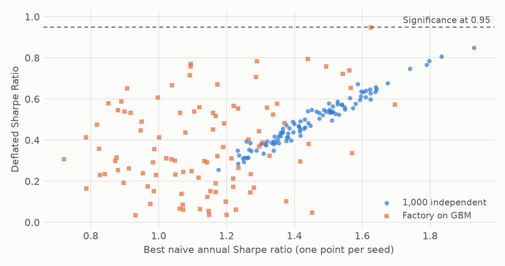
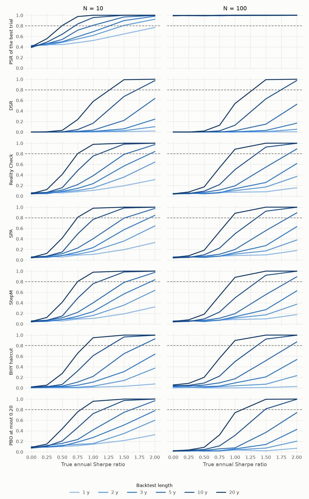
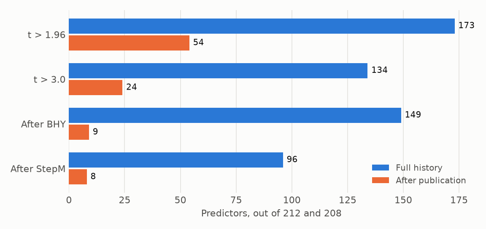
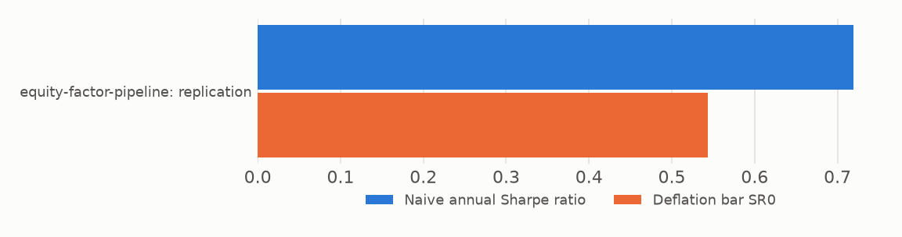

# Telling a real signal from a lucky one

## Executive summary

The best of 1,000 strategies on pure noise shows a median annual Sharpe ratio of 1.43. A naive test calls it significant in 100 of 100 seeds, and the Deflated Sharpe Ratio in none. We built the published corrections into one library, checked them against the papers and simulations, and applied them to real data. A 1,034-variant ETF search with a Sharpe ratio of 0.76 fails, because luck alone reaches 0.83. Of 208 academic predictors, 54 clear t > 1.96 after publication, and 8 survive a stepdown test. The practical lesson is that the trial count decides the verdict: in one of our own projects, three families pass when judged alone, and none passes at the project's whole count. Detection also takes time, often 20 years for a true Sharpe ratio of 1.

## Problem

A backtest report shows the winner and hides the search. The expected best of N trials with no edge rises with N and with the spread of their Sharpe ratios, so a high Sharpe ratio alone says little. Three errors compound. Selection picks the luckiest trial. Fat tails and negative skew make the estimate less precise than it looks. Overlapping labels leak across a cross-validation split and inflate accuracy.

Each has a published correction, but the corrections are scattered, their inputs are rarely recorded, and their failure modes are seldom measured. We asked whether they work together in practice, and where they break.

## Method

We implemented six families of tools in `overfitlab`:

- **PSR and DSR** correct a Sharpe ratio for sample length, skew, kurtosis, and the number and variance of trials.
- **PBO** measures how often the in-sample winner falls below the median out of sample.
- **The Reality Check, SPA and the Romano–Wolf stepdown** test whether anything in a set beats a benchmark, and which strategies do.
- **The Harvey–Liu haircut** converts multiple testing into a lower Sharpe ratio.
- **Purged k-fold and CPCV** cross-validate overlapping labels without leakage.
- **A verdict gate** requires the DSR, PBO, SPA, the stepdown and the haircut to pass together.

Trials are recorded in an append-only log with a frozen contract, so N and V come from a record. Failed runs and hand iterations count.

Validation came first. Paper examples test the formulas: 39 of 40 match within tolerance. Closed-form power tests the rejection rates. Independent implementations test the bootstrap methods, which have no printed examples: `arch`, then `bsds.m` and `StepwiseTest`, because `arch` doesn't studentise.

We then ran three kinds of experiment: simulations with known truth, public data, and the owner's trial logs.

## Results

| Experiment | Result |
|---|---|
| Best of 1,000 on noise | Median best Sharpe 1.43, DSR significant in 0 of 100 seeds, median PBO 0.50 |
| 1,034 factory variants on noise | Median best Sharpe 1.13, DSR significant in 0 of 100 seeds, median PBO 0.52 |
| Leakage on noise | Shuffled k-fold accuracy 0.703, purged 0.495 |
| Factory on 12 ETFs | Sharpe 0.76, bar 0.83, DSR 0.39, PBO 0.31, FAIL |
| 212 OSAP predictors, full history | 173 at t > 1.96, 96 after StepM |
| 208 OSAP predictors, after publication | 54 at t > 1.96, 8 after StepM |

**Noise.** The corrections do what they claim. The naive test is wrong in 199 of 200 seeds, and the DSR is never fooled.

**Leakage.** Shuffled k-fold reports 70% accuracy on data with nothing to find. Purging returns it to a coin toss.

**Power.** This is the cost of honesty. With a true Sharpe ratio of 1 among 100 trials, the Reality Check, SPA and the stepdown need 20 years for 80% power. A single pre-registered test needs 10 years on the same grid. Each extra trial spends statistical power, so a search isn't free even if it's reported honestly.

**A real search.** The factory on 12 ETFs selected a moving-average rule with a Sharpe ratio of 0.76. The bar from 1,034 trials is 0.83, the DSR is 0.39, and the verdict is FAIL. Its holdout Sharpe ratio is 0.68. So the strategy may well make money, but the backtest can't show it beat luck. SPA and the stepdown do reject here, because they test against zero and a long-only strategy has the equity premium behind it.

**The factor zoo.** Of 212 predictors over their full histories, 173 clear t > 1.96 and 96 survive the stepdown. After publication, 54 of 208 clear t > 1.96, 24 clear t > 3, and 8 survive. Across 56 long factors from Ken French's library and AQR's datasets, used with AQR's permission, 30 survive.

**Our own work.** `equity-factor-pipeline` is the only one of six projects with a trial log. Of its eight families, `investment`, `low_risk` and `quality` pass when each is judged on its own trials, with DSRs of 0.952, 0.957 and 0.951. But the project ran 613 trials. At that count their DSRs fall to 0.429, 0.734 and 0.678, and none passes. `investment` fails outright: the bar of 1.03 exceeds its Sharpe ratio of 1.00.

Neither count is simply right. If the families were separate ideas, each own count is fair. If they came from one search that kept what worked, the whole count is. The verdict turns on a fact about the research process that no return series contains.

## Implications for a PM

- **Ask for N and V before the Sharpe ratio.** A number without its search can't be judged. A trial log costs almost nothing, and a log kept by hand always undercounts.
- **Decide what a family is before looking.** As our own table shows, this choice can decide the verdict, so it should be fixed in advance.
- **Discount the backtest by the bar and not by a rule of thumb.** A flat 50% haircut is too harsh on strong results and too kind to weak ones. The haircut on our factory is about half, and on our strongest factor, AQR's international stock-selection multi-style series, it's 7%.
- **Budget for time.** A Sharpe ratio of 1 can take decades to prove from a wide search. Pre-registering fewer ideas buys more than a longer search does.
- **Use a holdout, once.** PBO reads near 0 for an edge that died halfway through, and only fresh data catches that.
- **Treat a pass as a failure to reject luck, and not as proof of an edge.** A failure doesn't prove there's no edge either, as the factory's holdout shows.

## Limitations

- **The DSR is conservative at small N.** It missed its reference power at three cells: 0.036 against 0.168, 0.149 against 0.207, and 0.003 against 0.056. V comes from the same trials as the winner, so a real signal raises its own bar. A version given the true V matches. We kept this as a finding and changed no limit.
- **N is a lower bound.** A log records what ran, not what was considered, or what a borrowed idea had already been through.
- **Benchmarks are zero.** A long-only strategy can pass the bootstrap tests on the equity premium alone.
- **Post-publication samples are shorter.** Fewer survivors partly reflects less data, so the drop isn't all decay.
- **Coverage is thin.** One of six projects has a trial log.
- **Validation has gaps.** One paper example misses by 5e-6, and one of 20 cross-check cases differs because the reference has no floor when no strategy has a positive mean. Both are documented on the [validation page](validation.md).
- **Power curves assume independence,** with one planted signal among otherwise null strategies.
