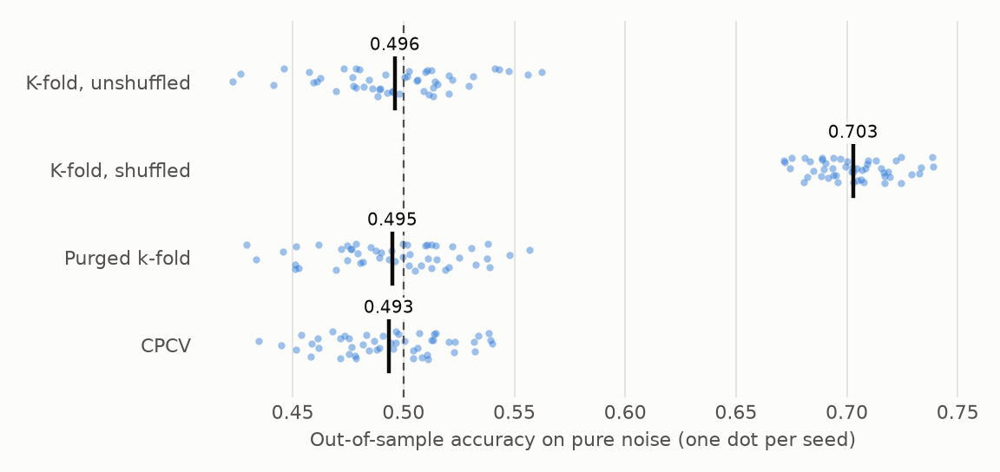

# Cross-validation with overlapping labels

**The question: what leaks in standard k-fold with overlapping labels, and how do purging and embargo fix it?**

A label built from the next 20 days of returns overlaps its neighbours in time. Shuffled k-fold puts neighbours on both sides of the split, so the test label is almost in the training set. With autocorrelated features, a tree model finds the neighbour and reads off the answer.

On pure-noise prices, shuffled k-fold reports an accuracy of 0.70. Nothing is predictable, so that's all leakage. Purged k-fold gives 0.495 and CPCV 0.493, both consistent with a coin. The numbers are in `reports/tables/leakage.csv`.

## Purging and embargo

Each label spans an interval from `t0` to `t1`.

**Purging** removes from training any row whose interval overlaps a test interval. That covers rows before the test fold, whose labels run into it, and rows after it, whose labels started inside it.

**The embargo** then removes a further `ceil(embargo_pct * T)` rows after each test fold, counted from the end of the purge. It guards against dependence that outlasts the labels. Counted from the fold itself it would sit inside the purge and do nothing.

## Combinatorial purged CV

Standard walk-forward gives one path, so one Sharpe ratio. CPCV divides the sample into N groups and tests every combination of k of them. That gives C(N, k) splits and k/N · C(N, k) complete backtest paths: with N = 6 and k = 2, 15 splits and 5 paths. A distribution of outcomes replaces a single history. `path_map()` and `assemble_paths()` rebuild the paths from per-split predictions.

Unshuffled k-fold shows no inflation here, because only the fold edges leak and they're few. That doesn't make it safe: the gap stays hidden until labels get longer or features more persistent.
