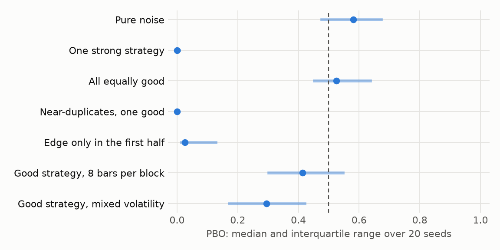
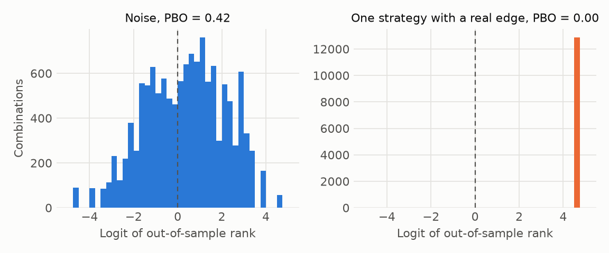

# Probability of Backtest Overfitting

**The question: when is PBO misleading?**

CSCV cuts the sample into S blocks, picks the in-sample winner for every way of taking half of them, and asks where that winner ranks on the other half. PBO is the share of splits in which it lands in the lower half. Near 0.5 means selection found nothing. Near 0 means the winner stays a winner.

The catch is that PBO measures whether **ranking** persists, not whether money is made. So it can mislead in both directions.

**High PBO, no harm.** With 50 strategies that all have a Sharpe ratio of 1, PBO is about 0.5, the same as noise. Nothing is overfit: every pick is fine, and the ranking among equals is just noise. PBO alone can't tell this apart from pure luck. Check the level with the DSR or the out-of-sample performance that CSCV also reports.

**Low PBO, real harm.** An edge that exists only in the first half of the sample gives a PBO near 0. The in-sample winner keeps winning across most splits, because every split contains part of the good period. PBO says nothing about whether the edge is still alive. This is why a holdout matters.

**Too little data.** With 8 bars per block, a strategy with a real edge scores about 0.4. The blocks are too short to rank anything, so the contract asks for 20 bars per block before PBO counts.

**Mixed risk.** When volatilities differ a lot across trials, Sharpe rankings get noisier, and the same good strategy reads about 0.3.

**Near-duplicates.** One good strategy among near-copies gives a PBO near 0, which is correct here, but N and V still have to be read with care: the set holds far fewer independent ideas than it seems.

## How to read it

Use PBO as one piece of evidence. A high value warns that selection may be adding nothing, and a low value doesn't prove an edge. The verdict gate requires PBO to pass alongside the DSR, SPA, the stepdown and the haircut for this reason.
