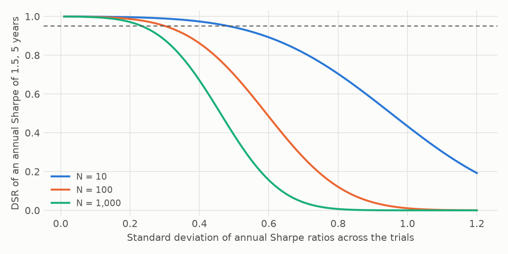

# PSR and the Deflated Sharpe Ratio

**The question: why does the DSR use the variance of trial Sharpes, not just the count?**

Because the count alone doesn't say how far luck can reach. The expected best of N trials is

SR₀ = √V · ((1 − γ)·Φ⁻¹(1 − 1/N) + γ·Φ⁻¹(1 − 1/(N·e)))

so the bar scales with √V, the spread of the trial Sharpe ratios. Two searches with the same N can have very different bars.

The figure holds one backtest fixed: an annual Sharpe ratio of 1.5 over five years. At a spread of 0.3, it passes 0.95 with N = 10, only just with N = 100, and fails with N = 1,000. At a spread of 0.6, it fails at every N.

**Near-duplicates.** A hundred parameter tweaks of one idea give almost identical Sharpe ratios, so V is small and the raw count overstates the bar. **Diverse searches.** A hundred unrelated ideas spread widely, so V is large and the bar is high. V is what tells the two apart.

## What PSR adds

The Sharpe ratio is an estimate, and its error depends on the shape of the returns:

σ(SR) = √((1 − γ₃·SR + (γ₄ − 1)/4·SR²) / (T − 1))

Negative skew and fat tails widen it. PSR is the probability that the true Sharpe ratio beats a benchmark, given that error. The DSR is PSR with SR₀ as the benchmark, so it corrects for both luck and shape.

In the [DSR paper's example](../validation.md), a 2.5 Sharpe from 100 trials has a DSR of 0.9004: below 0.95, even though the naive figure looks excellent.

## How to read it

- A DSR above 0.95 says the Sharpe ratio is unlikely to be the luck of the best trial, assuming the N and V you gave it are honest.
- N must include everything you looked at, failures too. See [trial counting](trial-counting.md).
- V is estimated from the same trials as the winner, so a strong outlier raises its own bar. That makes the DSR conservative, and on simulated data it falls short of the known-V reference when N is small. See [reference power](power.md).
