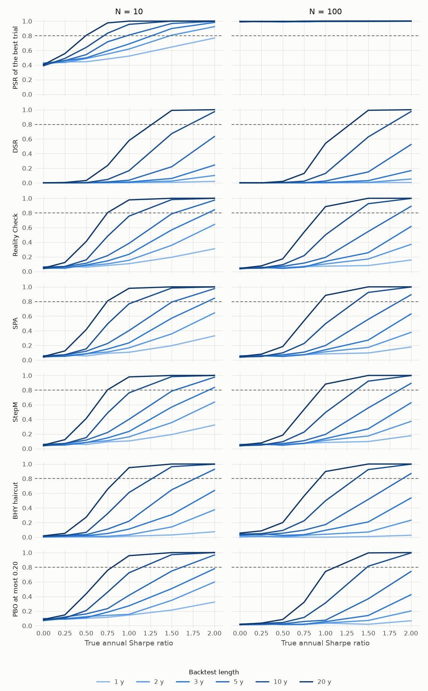

# Data-snooping tests

**The question: how do White's Reality Check, Hansen's SPA and the Romano–Wolf stepdown differ, and which has more power when many useless strategies are included?**

All three ask whether the best of many strategies beats a benchmark once the search is accounted for. Each resamples the returns with a stationary bootstrap and compares the observed best with the distribution of the resampled best.

| Test | Statistic | Null imposed | Answers |
|---|---|---|---|
| Reality Check | Raw mean | Every strategy exactly at the benchmark | Is anything better? |
| SPA | Studentised mean | Bad strategies are set aside | Is anything better? |
| StepM | Studentised mean, stepping down | As above, repeated | Which ones are better? |

## Why SPA improves on the Reality Check

Two weaknesses of the Reality Check motivate it. Raw means let the most volatile strategies dominate the maximum, so SPA divides by each strategy's long-run standard deviation. And recentring every strategy at zero treats hopeless strategies as if they could win, which inflates the null. SPA's consistent p-value leaves strategies far below the benchmark out, so adding useless strategies costs it less.

## What the StepM adds

SPA gives one verdict for the set. The stepdown rejects the strategies that clear the bootstrap critical value, removes them, recomputes the value for those left, and repeats until nothing more is rejected. It controls the familywise error rate and names the survivors.

## In the power curves

With independent strategies of equal volatility, the three coincide, because the features that separate them don't come into play. Differences appear with unequal volatility or many clearly bad strategies. The power falls as N rises, since the bar rises, and the naive PSR of the best trial shows why a correction is needed: at N = 100 it "detects" a signal nearly always, even when there is none.

## Validation

There are no printed examples, so these are cross-checked. The `arch` package does not studentise, so `bsds.m` and `StepwiseTest` provide the studentised check. See [validation](../validation.md).
