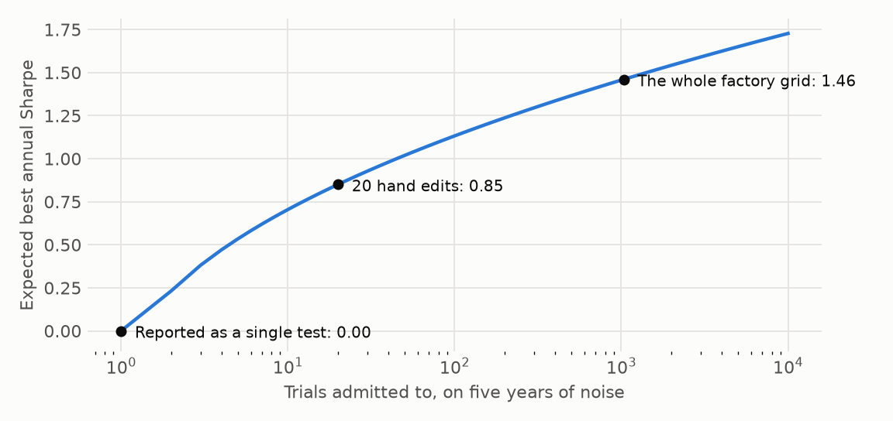

# Counting trials honestly

**The question: how do you count trials honestly when you iterated by hand?**

Count every evaluation whose result you looked at. That includes grid points, random draws, notebook edits you re-ran, abandoned ideas, and the final holdout. A trial you looked at and rejected still shaped what you kept.

On five years of noise, reporting a single test implies a bar of zero. Admit to 20 hand edits and the expected best annual Sharpe ratio is 0.85. Admit to a 1,034-variant grid and it's 1.46. The same backtest can be impressive or ordinary depending only on this number, which is why it has to be recorded and not recalled.

## What makes the count hold up

**Log inside the evaluation function.** If logging sits in the shared backtest function, calling code can't skip it. A log kept by hand always undercounts. The [contract](../trial-log.md) requires this.

**Log failures.** A run that crashed or was aborted counts in N, with `n_obs = 0`. `TrialLogger.log_failed` does this.

**Log ideas with no saved series.** `overfitlab trials add-manual` records a hand iteration. It counts in N and stays out of V, because no return series exists.

**Keep the log append-only.** Rows are never edited or removed, and `git_sha` ties each to its code. A re-run appends a row. `mode="dedup"` collapses identical trials when you want that.

## Raw and effective N

Near-duplicates aren't independent, so the raw count can overstate the bar. `n_trials(mode="clustered")` estimates independent trials by clustering return correlations, with distance √((1 − ρ)/2) and the number of clusters chosen by the mean silhouette. It follows the idea of López de Prado and Lewis (2019).

The headline uses raw N, which is conservative and needs no modelling (D-08), with clustered N beside it. One sibling project shows the gap: 20 logged trials cluster to 7.

## What the count can't fix

A log records what was run, not what was thought about. Ideas dropped from reading a chart, or borrowed from a paper that ran its own search, aren't in it. Treat N as a lower bound.
